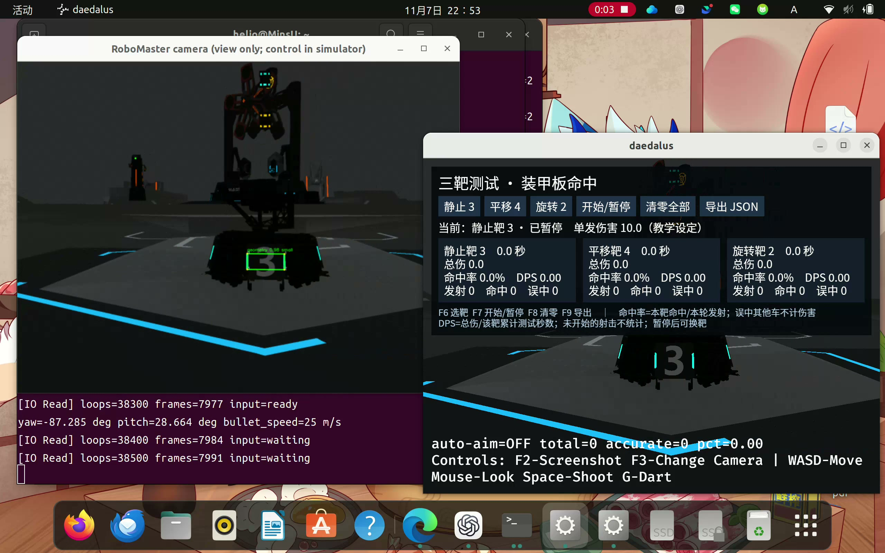

# 第三讲：OpenCV 装甲板检测

本分支只保留 C++ OpenCV 检测实现。输入相机 BGR 图像，筛选左右灯条并组成装甲板，输出四角点、大小板判断和几何质量评分，在第二讲订阅的相机画面中绘制检测四边形。

## 作业入口

| 内容 | 文件 |
|---|---|
| 课程检测函数与画框 | [lesson03_detection.cpp](../lessons/lesson03_detection.cpp) |
| 检测接口 | [armor_detector.hpp](../include/armor_detector.hpp) |
| 本次用户实录，MP4、15.63 秒 | [opencv-submission.mp4](artifacts/opencv-submission.mp4) |
| 本次实录截图 | 下图及 [opencv-submission.jpg](artifacts/opencv-submission.jpg) |
| ROS2 与课程接口测试 | [tests.log](artifacts/tests.log) |
| 独立检测测试 | [standalone-tests.log](artifacts/standalone-tests.log) |
| 真实图片检测统计 | [opencv-metrics.json](artifacts/opencv-metrics.json) |



本次录屏由学员亲手操作录制，源文件为 `录屏 2026年11月07日 22时53分37秒.webm`。提交副本转换为 H.264 / MP4（15.63 秒），保留整个演示过程；画面包含相机检测窗口、云台角度变化以及观察位置移动，不包含程序启动流程。

## 检测过程

1. 分离 B、G、R 通道，以 B−R 或 R−B 提取蓝、红颜色优势区域。
2. 颜色差值大于 45，同时相应颜色通道亮度大于 110，形成候选掩码。
3. 使用 3×3 闭运算连接细小缝隙，查找轮廓并计算最小外接旋转矩形。
4. 通过面积、长宽比和倾角排除不符合灯条形状的区域。
5. 对同色灯条检查长度比例、竖直错位、夹角与间距比例，排除跨越第三根灯条的配对。
6. 按几何质量排序，避免一根灯条被多块装甲板重复使用。
7. 输出左上、右上、右下、左下四角点，由 `draw_armors` 在图像副本中画框；输入原图不被修改。

颜色几何规则不识别装甲板数字，`class_id=-1` 表示编号未知。画面中的 `geometry` 是几何匹配质量评分，不能当作概率或准确率。灯条间距/长度比大于 3.2 时作大装甲板启发式判断；无目标返回空列表。

## 本机直接运行

本机已编译的仿真器位于现有运行目录。终端一：

```bash
cd /home/helio/RM_Week1_Build/hnurmvision_edu
bash scripts/lesson02.sh simulator
```

第三讲检测程序位于本作业目录。终端二：

```bash
cd /home/helio/RM_Lesson03_Work/repo
bash lesson03/scripts/run.sh training
```

点击相机窗口后按 q 或 Esc 退出；也支持在检测程序终端按 Ctrl+C。仿真器和检测程序使用相同 ROS_DOMAIN_ID，默认 89。

## 编译与测试

具备 ROS2 Humble、OpenCV、Eigen3、yaml-cpp 等仓库依赖后，从仓库根目录执行：

```bash
bash scripts/lesson02.sh build
bash scripts/lesson02.sh test
```

只运行检测视频工具时，可独立构建，不需要 ROS2、Python 或模型权重：

```bash
cmake -S lesson03 -B lesson03/build -DCMAKE_BUILD_TYPE=Release
cmake --build lesson03/build -j2
ctest --test-dir lesson03/build --output-on-failure
lesson03/build/armor_video INPUT.mp4 output.avi 300 show
```

`lesson03/requirements.txt` 仅服务于可选的 Python 数据整理与评估工具，不是 C++ 检测器的依赖。

## 结果与边界

历史固定场景相机验收中，491 帧都有至少一个检测结果；这是该场景的检测覆盖统计，不代表所有目标都正确识别。本次新增录屏展示了操作移动时的画框效果。

保留的 240 张真实验证图片上，类别无关包围框 IoU≥0.5 的贪心匹配统计为 TP=60、FP=174、FN=342，Precision=25.64%、Recall=14.93%。固定阈值仍会受到暗光、小目标、遮挡、场地灯光等干扰，不能宣称全场景稳定识别。

本分支包含第二讲 IO 与仿真相机修复作为运行前提。录屏中的自动瞄准或命中计分不属于本次装甲板检测的验收指标。

## 资料来源

- 课程压缩包中的《第三讲 识别一块装甲板——OpenCV和神经网络入门》任务说明；本项目选择其中的 OpenCV 检测实现。
- `3.2-OpenCV基础 (1).zip`：二值化、形态学、轮廓检测与最小外接矩形章节。
- [课程原始仓库](https://github.com/Exusiai-R/hnurmvision_edu)。
