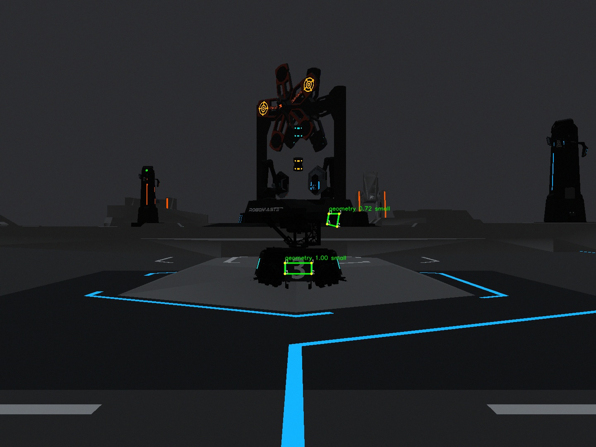
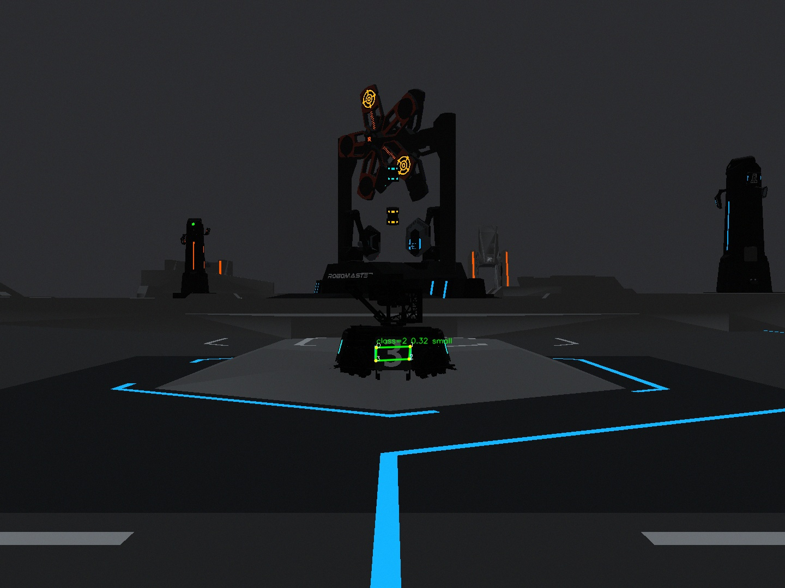
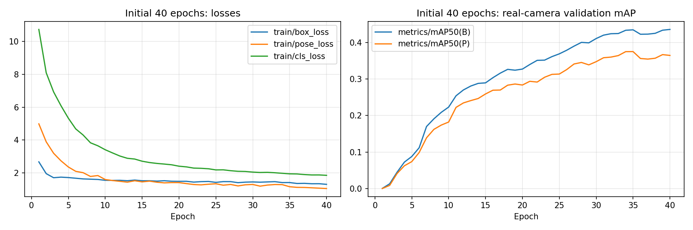
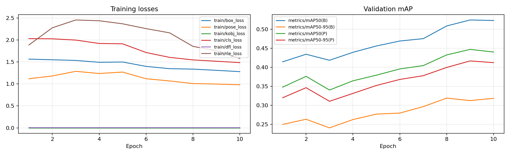
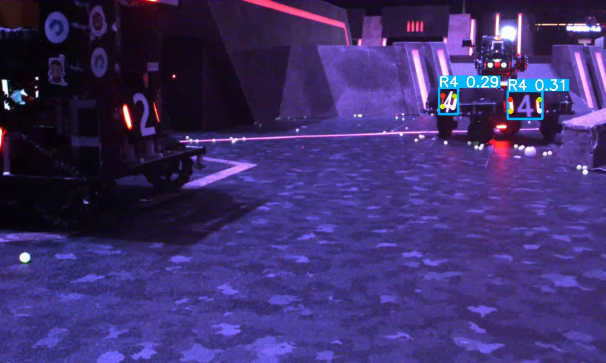

# 第三讲：装甲板检测 · OpenCV 与神经网络双路线

本作业同时实现两条路线，均接入 `training::lesson03_detection(const cv::Mat&)`，返回课程规定的 `Armor`，并在相机图像中绘制装甲板四边形、角点序号与分数。神经网络额外提交真实训练得到的 `best.pt`、`last.pt`、置信度可视化、loss 与 mAP 曲线。

## 作业验收入口

| 要求 | 实现或产物 |
|---|---|
| 补全检测函数 | [`lesson03_detection.cpp`](../lessons/lesson03_detection.cpp)、[`lesson03_neural.cpp`](../lessons/lesson03_neural.cpp) |
| OpenCV 相机画框 | [桌面运行录屏](artifacts/opencv-desktop.webm)、[完整相机画面](artifacts/opencv-camera.webm) |
| 神经网络相机画框 | [真实仿真桌面录屏](artifacts/neural-desktop.webm)、[完整相机画面](artifacts/neural-camera.webm)、[真实验证图推理](artifacts/neural-holdout.webm) |
| 最佳与最终权重 | [`best.pt`](artifacts/best.pt)、[`last.pt`](artifacts/last.pt) |
| 置信度图片 | [`predictions/`](artifacts/predictions/) |
| 训练 loss、验证 mAP | [训练曲线](artifacts/training-curves.png)、[原始逐轮 CSV](artifacts/results.csv) |
| 验证指标、原始配置 | [`metrics.json`](artifacts/metrics.json)、[`args.yaml`](artifacts/args.yaml) |
| 数据检查与可复现划分 | [`data-audit.json`](artifacts/data-audit.json)、[`data-manifest.json`](artifacts/data-manifest.json) |
| C++ 测试 | [`tests.log`](artifacts/tests.log) |











## 路线一：传统 OpenCV（C++17）

流程：B/R 通道差与亮度双阈值 → 闭运算 → `findContours` → `minAreaRect` → 长宽比、倾角过滤 → 同色灯条几何配对 → 中间灯条排除与共享灯条去重。

配对检查长度比例、竖直偏移、夹角和灯条间距/长度比；四个角点来自左右灯条的上下端点。宽高比大于 3.2 视为大装甲板，这是视觉启发式判断。输出编号为 `-1`，因为灯条几何不能识别数字。`geometry` 后的分数是几何质量评分，不是经过校准的概率。

真实仿真相机采集 491 帧，491 帧至少检测到一块装甲板；这项统计只表示这一段场景中的检测覆盖率，不是准确率。独立保留的真实数据验证图上，以四角点包围框和标注框进行类别无关 IoU≥0.5 匹配，结果见 `opencv-metrics.json`。固定阈值在暗光、小目标、光照变化和场地干扰下仍会漏检或误检。

## 路线二：YOLO26n-Pose（真实 GPU 训练 + C++ 接入）

模型预测 14 类装甲板、边界框与 4 个角点；从官方预训练权重微调。类别顺序遵循课程参考项目：

```text
0 B1, 1 B2, 2 B3, 3 B4, 4 B5, 5 BO, 6 BS,
7 R1, 8 R2, 9 R3, 10 R4, 11 R5, 12 RO, 13 RS
```

**角点转换**：数据集顺序为 `左上、左下、右下、右上`，课程接口要求 `左上、右上、右下、左下`。推理明确使用索引 `[0,3,2,1]` 转换，保留原始预测的对应关系。

C++ 通过 `socketpair` 和 `fork/exec` 启动常驻 Python 推理进程，逐帧传递 BGR 字节，接收四角点、类别和置信度。模型只加载一次，同类别重叠四角点执行 IoU 去重；无临时逐帧文件，无 shell 拼接。协议 stdout 与模型日志隔离；进程异常、响应超时和未知后端显式报错。程序退出时回收子进程。此实现运行于 Linux，适合现有 Ubuntu/ROS2 教学环境。

### 训练设置与结果

使用讲义自带 `dataset.zip`，检查全部原始图片对应的标签列数、类别和归一化坐标。按原 `train`/`val` 边界，固定种子 `20261102`，按首个目标类别轮流抽样 1,200 张训练图、240 张验证图；用 SHA-256 排除所选集合内及集合间完全相同的图片。保留原标注，不上传整份课程数据。相邻视频帧仍可能相关，因此这不是跨场景独立测试。

训练设备为 RTX 5060 Laptop GPU，PyTorch 2.10.0+cu128，Ultralytics 8.4.35；640×640、batch=16、初始 40 epochs、AdamW、关闭 AMP、固定随机种子。完整参数在 `args.yaml`，实际耗时和版本在 `environment.json`。

| 原 240 张真实验证图，最终 best.pt | 数值 |
|---|---:|
| 框 mAP@50 | 51.17% |
| 框 mAP@50:95 | 31.03% |
| 角点 mAP@50 | 42.65% |
| 角点 mAP@50:95 | 39.86% |


传统路线在同一验证集的类别无关 IoU≥0.5 检测统计：TP=60、FP=174、FN=342，Precision=25.64%、Recall=14.93%。该结果提示固定灯条阈值对真实图片的泛化有限；它与需要类别正确匹配的 YOLO mAP 不是同一种指标，不能直接横向比较。

初始真实数据模型在仿真录像的 60 帧中未检出目标，失败记录保存在 `real-only-simulation-failure.log`。为接通教学仿真场景，另外人工检查固定相机中正前方 B3 装甲板的四角点，加入 147 张仿真训练帧与 17 张同场景验证帧，混合原有真实图片继续训练 10 轮。标注坐标、帧编号和已知边界见 `simulation-labels.json` 与 `simulation-label-review.jpg`；只标注正前方装甲板，其余目标未完整标注。这是特定固定场景适配，不能当作跨场景泛化或独立测试。

最终 `metrics.json` 会再次只在原 240 张真实验证图片上计算；`real-only-metrics.json` / `real-only-results.csv` 保留适配前结果。最终曲线展示适配阶段，初始 40 轮曲线数据单独保留。

适配后重新启动真实仿真器，通过 ROS2 相机接入 C++ 检测，采集 587 帧，587 帧检测到前方装甲板。此数据是同场景运行验收，不是独立准确率。

训练曲线每轮验证，`best.pt` 由框架的验证 fitness 选择，`last.pt` 是最终轮权重。保留了全部 24 张固定顺序的可视化，包括漏检和错分类情况，没有将模型输出当作标注。展示图片来自保留验证集，以 `conf=0.25` 推理，直接显示类别和置信度。指标只对应这次小数据训练和相应验证集，不代表完整数据集或实车部署性能。

## 编译和运行

以下命令均从仓库根目录执行。完整 ROS2 程序沿用仓库构建入口：

```bash
bash scripts/lesson02.sh build
bash scripts/lesson02.sh test
# 终端 1：启动已构建的仿真器
bash scripts/lesson02.sh simulator
# 终端 2：OpenCV 相机检测
RM_DETECTOR=opencv bash lesson03/scripts/run.sh training
```

神经网络环境：Python 3.10+；CUDA 版 PyTorch 应与显卡驱动匹配，CPU 也可以运行。

```bash
python3 -m venv .venv-lesson03
.venv-lesson03/bin/pip install torch==2.10.0 torchvision==0.25.0 --index-url https://download.pytorch.org/whl/cu128
.venv-lesson03/bin/pip install -r lesson03/requirements.txt
export RM_PYTHON="$PWD/.venv-lesson03/bin/python"
export RM_POSE_WEIGHTS="$PWD/lesson03/artifacts/best.pt"
RM_DETECTOR=neural bash lesson03/scripts/run.sh training
# CPU 推理可显式设置 RM_POSE_DEVICE=cpu
```

不需要 ROS2 的图片/视频检测，可独立构建第三讲：

```bash
cmake -S lesson03 -B lesson03/build -DCMAKE_BUILD_TYPE=Release
cmake --build lesson03/build -j2
ctest --test-dir lesson03/build --output-on-failure
# 输入原始视频，输出 MJPEG AVI；末尾 show 参数显示 GUI
RM_DETECTOR=opencv lesson03/build/armor_video INPUT.mp4 output.avi 300 show
RM_DETECTOR=neural lesson03/build/armor_video INPUT.mp4 neural.avi 300 show
```

使用已录制的真实相机帧检查 ROS2 完整调用链时，先在一个终端运行 `ROS_DOMAIN_ID=91 build/camera_replay INPUT.avi`，再在另一终端用相同 domain 启动检测。此时输入是明确标注的录像回放，不应称为实时实车测试。

`RM_DETECTOR` 默认 `opencv`；神经网络权重、解释器与 worker 路径分别可用 `RM_POSE_WEIGHTS`、`RM_PYTHON`、`RM_POSE_WORKER` 指定；默认置信度阈值 0.25，可设置 `RM_POSE_CONF`。相机窗口按 Esc 退出，主程序支持 q/Esc/Ctrl+C。

### 复现训练

先从课程压缩包解出 `dataset.zip`，再解压得到含 `train/images`、`train/labels`、`val/images`、`val/labels` 的目录：

```bash
.venv-lesson03/bin/python lesson03/scripts/prepare_data.py /path/to/dataset /path/to/new-subset
.venv-lesson03/bin/python lesson03/scripts/train.py \
  --data /path/to/new-subset/armor.yaml --epochs 40 --device 0 \
  --project "$PWD/lesson03/runs" --name armor26-reproduce
.venv-lesson03/bin/python lesson03/scripts/report.py \
  --run lesson03/runs/armor26-reproduce \
  --data /path/to/new-subset/armor.yaml --out lesson03/artifacts-reproduce
```

首次运行会下载 `yolo26n-pose.pt`，也可用 `--model /path/to/yolo26n-pose.pt` 指定已下载的权重。数据输出目录必须不存在，避免覆盖。不同 CUDA/硬件环境可能产生数值差异，固定种子不等于跨硬件逐位一致。

## 实现边界与参考

本分支包含第二讲 IO 和相机修复作为第三讲运行前提，保留第四、第五讲教学接口。检测输入不可修改；没有目标返回空列表；颜色几何路线不虚构数字分类。这里只实现识别，不将检测分数视为发射许可。

- 作业来源：`第三讲 识别一块装甲板——OpenCV和神经网络入门.zip` 内 Markdown。
- OpenCV 基础参考：`3.2-OpenCV基础 (1).zip` 第 3.12 节阈值、第 4.7 节形态学和第 7 节轮廓/外接矩形；检测实现为本作业编写。
- [课程原始骨架](https://github.com/Exusiai-R/hnurmvision_edu)。
- [课程提供的 YOLO26 参考项目](https://github.com/alectimison-maker/yolo26_pose_rmvision)：采用其类别表与角点语义；这里独立实现数据划分、训练入口和 C++ worker。
- [Ultralytics Pose 官方文档](https://docs.ultralytics.com/tasks/pose/)：训练、验证及预测接口。使用与再分发应遵守仓库和相关依赖各自的许可。

### 复现仿真适配阶段

先完成上述 40 轮真实数据训练，再使用同一固定相机的原始录像构造适配数据（相机位姿或分辨率改变后必须重新标注，不能复用固定坐标）：

```bash
.venv-lesson03/bin/python lesson03/scripts/prepare_sim_adaptation.py /path/to/new-subset camera-raw.avi /path/to/new-adaptation
.venv-lesson03/bin/python lesson03/scripts/train.py --data /path/to/new-adaptation/armor.yaml \
  --model lesson03/runs/armor26-reproduce/weights/best.pt --epochs 10 \
  --project "$PWD/lesson03/runs" --name armor26-adapt-reproduce
```

本机已经配置好独立环境，可直接复用，无需再次安装：

```bash
cd /home/helio/RM_Lesson03_Work/repo
export RM_PYTHON=/home/helio/RM_Lesson03_Work/venv/bin/python
RM_DETECTOR=neural bash lesson03/scripts/run.sh training
```

原始仿真采集录像另有[压缩副本](artifacts/simulation-camera-raw.webm)，便于查看固定标注位置；无损中间 AVI 保留在本机，不纳入 Git。
