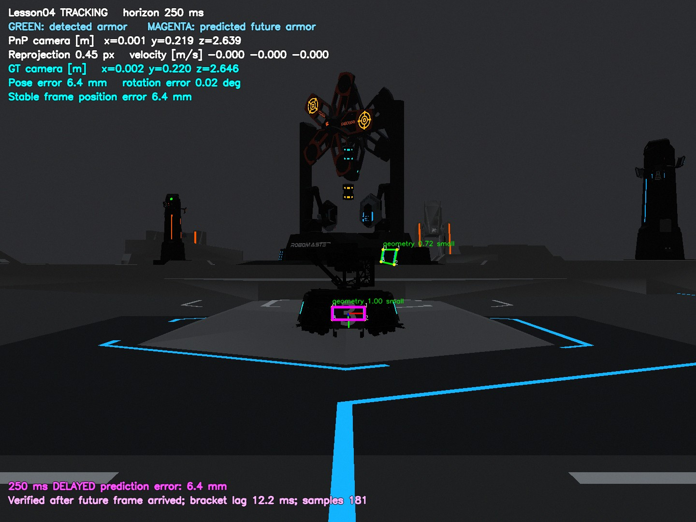
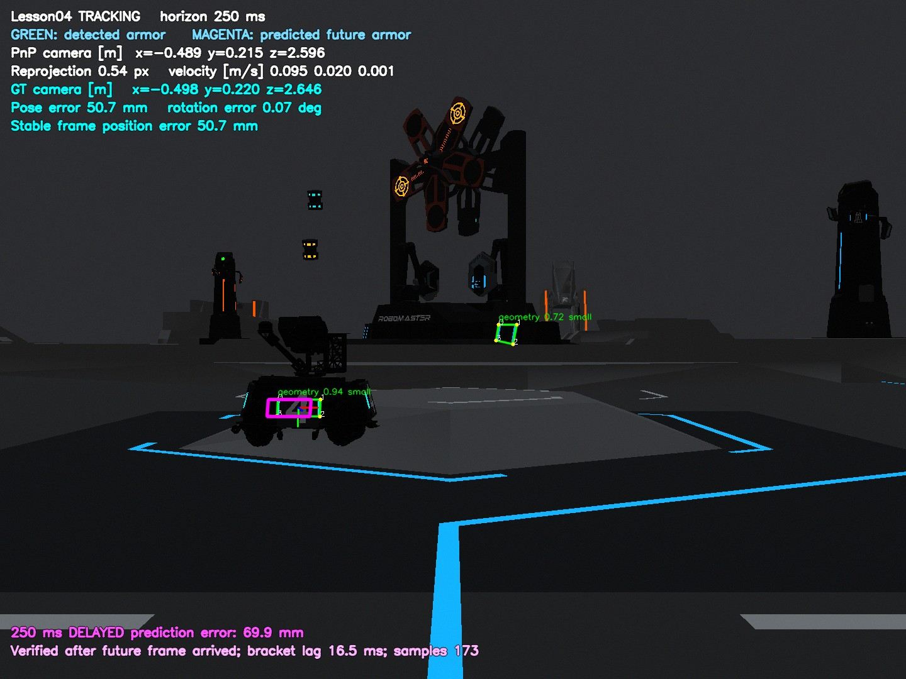
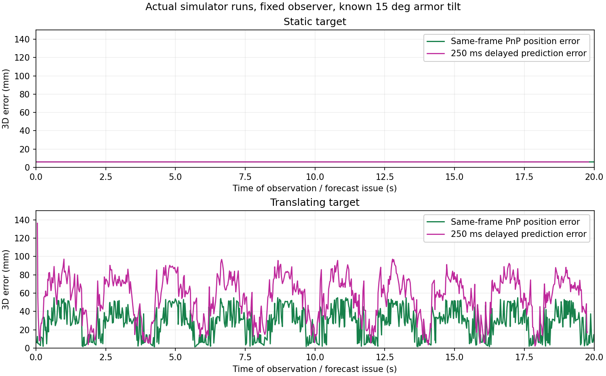

# 第四讲：从四个角点到三维位姿与未来位置

本作业沿用第三讲的 **C++ OpenCV 检测路线**，实现了 PnP 位姿、坐标变换、六维匀速卡尔曼滤波、选板与丢失状态机，以及可调预测时间和独立真值验收。

## 交付入口与任务对照

| 讲义要求 | 本次实现与证据 |
|---|---|
| PnP 求装甲板位置与姿态 | [位姿与跟踪实现](../lessons/lesson04_tracking.cpp)；画面显示相机系位置、姿态坐标轴、位置误差和姿态角误差 |
| 匀速模型/KF/EKF 跟踪与画框 | 六维线性 KF、预测关联、四状态管理；绿色为当前检测，紫色为未来预测 |
| 调研其他学校并尝试应用 | [西安理工 NEXT E、南京理工 Alliance 方案比较与采用的方法](research.md)，附固定提交的源码链接 |
| 静止靶：位姿与真实值比较 | [完整静止演示 MP4](artifacts/01-static-pnp.mp4)、[统计](artifacts/static-summary.yaml)、[逐帧 CSV](artifacts/static-poses.csv) |
| 平移靶：可变 n，默认 250 ms；未来到达后算误差并显示左下角 | [完整平移演示 MP4](artifacts/02-translation-250ms.mp4)、[延迟核验 CSV](artifacts/translation-forecasts.csv)；另有 100 ms 实测与命令行/键盘调整 |
| 提交 MP4 运行录屏 | **[18 秒真实桌面录屏 MP4，推荐提交](artifacts/00-overview-18s.mp4)**：前 6 秒静止、后 12 秒平移，可见实际窗口。另有[无桌面边框的相机画面合辑](artifacts/03-camera-overview-18s.mp4)；两段完整视频各约 20 秒，由实际程序的相机显示帧按采集时间导出 |

讲义第四讲明确要求 MP4，但没有给出视频时长上限或第四讲表单地址。合并视频为便于上传而剪辑；统计始终来自两段完整实测，没有按低误差片段筛选。

仓库中的相机视频为便于传输压缩至 1080×810、15 fps，时长和内容完整保留；原始 1440×1080 视频保存在本机 `/home/helio/RM_Lesson04_Work/original-videos`，交付文件夹也保留了完整原版。CSV 统计使用全部原始观测，不受视频压缩或抽帧影响。





## 实测结果

以下是 2026-11-15 在本机实际 ROS2/Bevy 仿真运行得到的结果，长度单位米，表内换算为毫米。观察车在启动 1.5 秒后固定；目标平移沿用原场景约 0.5 m 振幅、4 s 周期的正弦运动。算法使用已知机械尺寸与 15°倾角先验。

| 场景 | 有效位姿对照 | 平均位置误差 | 平均姿态角误差 | 已等到未来的预测条数 | 预测平均误差 | 预测 P95 | 预测最大误差 |
|---|---:|---:|---:|---:|---:|---:|---:|
| 静止，n=250 ms | 720 | 6.40 mm | 0.017° | 711 | 6.40 mm | 6.40 mm | 6.40 mm |
| 平移，n=250 ms | 780 | 27.40 mm | 1.562° | 768 | 55.51 mm | 88.06 mm | 136.26 mm |
| 额外平移短测，n=100 ms | 178 | 25.95 mm | 1.619° | 170 | 28.75 mm | 56.02 mm | 59.87 mm |

静止场景画面几乎不变，误差也几乎不变；其很小的姿态误差依赖已知机械倾角，不能外推到任意角度或真实相机。100 ms 是另一轮短测，用来核实参数生效，不能视为同一批数据上的严格模型对比。平移目标有加减速和拐点，匀速模型会有误差；最大值和完整原始记录均保留。

两段正式测试的未匹配帧、无效真值消息、无法核验的已到期预测均为 0。录制结束时尚未到期的预测不参与统计，因此预测数少于位姿数。P95 采用排序后 `floor(0.95*N)` 对应的次序统计量；程序中位数取上中位数。



验收文件：[静止统计](artifacts/static-summary.yaml)、[平移统计](artifacts/translation-summary.yaml)、[100 ms 统计](artifacts/horizon-100ms-summary.yaml)、[独立 CSV 审计结果](artifacts/audit.json)、[视频解码检查](artifacts/video-validation.json)、[4/4 自动测试](artifacts/tests.log)。

## 程序到底做了什么

可以把这一条链路理解为：**找到纸牌四个角 → 根据已知尺寸推算距离与朝向 → 统一到稳定坐标系 → 估计速度 → 猜它过一会儿在哪里 → 真等一会儿再检查猜得准不准。**

1. **OpenCV 找角点。** 保留第三讲灯条检测和配对。本分支把 PnP 四角调整为灯条外沿端点，与机械图的尺寸定义对应；旧第三讲分支保持原样。四点顺序为左上、右上、右下、左下。检测的 `geometry` 分数是几何评分，不是神经网络概率。
2. **PnP 求位姿。** 小板宽 0.135 m，大板宽 0.225 m，灯条高 0.055 m；物体系原点取中心。相机光学系 x 向右、y 向下、z 向前。IPPE 尝试平面多解，LM 精化，检查正深度和重投影 RMS ≤3 px。演示开启已知 15°倾角约束，对 yaw 做局部重投影搜索并求平移；保留门限与回退，基础接口默认不启用该先验。
3. **坐标变换。** `p_stable = R_imu * (R_camera2gimbal * p_camera + t_camera2gimbal)`。稳定系采用前/左/上轴方向；其原点是云台旋转中心，车移动时原点也移动。外参平移来自相机与云台刚体变换，而非目标位置拟合：[标定记录](artifacts/extrinsic-calibration.json)。
4. **持续选同一块板。** 初次使用几何评分、面积、画面位置和重投影误差选板。以后使用预测位置与观测的空间距离和马氏距离关联，减少来回换板。累计 3 次匹配确认进入 TRACKING；短暂丢失 TEMP_LOST，超过 0.18 s 转 LOST；图像间隔超过 0.3 s 重置。没有编号识别，因此不宣称具备按机器人编号的身份关联。
5. **卡尔曼滤波与预测。** 状态为 `[px,py,pz,vx,vy,vz]`，按真实相邻图像时间间隔更新 F/Q，Joseph 形式更新协方差。预测 `p_future = p_filtered + v_filtered * n/1000`。用当前观测姿态把未来板中心投回当前相机画出紫框。
6. **独立验收。** 仿真器从实际场景的装甲板标记点、相机和云台变换获取真值，在同一次图像捕获中绑定相同时间戳，发布 `/lesson04/ground_truth`。检测/PnP/KF 不接收真值；只有 [独立验收器](evaluation.cpp) 订阅它。

预测发出时保存 `issued_ns`、`due_ns = issued_ns+n` 与板 ID；等未来真值时间戳达到 due 后，才在前后两帧间插值得到到期时刻真实位置。插值跨度不得超过 100 ms。CSV 中的 `evaluated_ns >= due_ns`，所有时间戳以整数纳秒记录，避免浮点精度损失。停止时还没等到未来的记录不会被伪造或提前评分。

**三种数字不要混淆：** `Reprojection ... px` 是把三维角点投回图像的像素残差；`Pose error ... mm` 是同一帧 PnP 中心与独立真值的三维距离；左下角 `DELAYED prediction error` 是先前预测与 n 毫秒后真实位置的三维距离。`bracket lag` 是取到未来帧时超过到期时刻的时间，插值所求的仍是 due 时刻位置。

## 在这台电脑上手把手展示

已准备好的目录：`/home/helio/RM_Lesson04_Work/repo`。本机已经编译完成，可直接运行下面步骤。第四讲使用 ROS 域 94；请使用本节两个入口，避免把其他讲的相机话题混进来。

### 第一步：先展示静止靶

按 Ctrl+Alt+T 打开终端 1，逐行运行：

```bash
cd /home/helio/RM_Lesson04_Work/repo
bash lesson04/scripts/run.sh simulator static
```

等仿真场地出现约 3 秒。**保持终端 1 和仿真窗口开着。** 该模式会在启动 1.5 秒后固定观察车位置，方便复现，不需要按移动键。

再按 Ctrl+Alt+T 打开终端 2：

```bash
cd /home/helio/RM_Lesson04_Work/repo
bash lesson04/scripts/run.sh demo --seconds 30 --horizon-ms 250
```

找到标题为 **Lesson04 Pose + Tracking** 的窗口，放大到便于阅读。另一个仿真窗口是场地，带文字和绿色/紫色框的才是作业展示窗口。

按顺序指出：

1. 绿色框：这一帧 OpenCV 识别到的装甲板；小坐标轴表示 PnP 姿态。
2. 左上 `PnP camera [m]`：算法估算的 x/y/z；`GT camera [m]`：同一图像时刻的独立真实值。
3. `Pose error ... mm` 与 `rotation error ... deg`：位置与姿态误差。
4. 靶不动，速度应接近零，紫框基本停留在原处。

30 秒后展示程序自动结束；也可点展示窗口按 q/Esc 提前退出。回终端 1 按 Ctrl+C 结束这轮仿真，再进行下一步。

### 第二步：展示平移靶与真正延迟核验

终端 1 运行：

```bash
cd /home/helio/RM_Lesson04_Work/repo
bash lesson04/scripts/run.sh simulator translation
```

等场地出现约 3 秒，终端 2 运行：

```bash
cd /home/helio/RM_Lesson04_Work/repo
bash lesson04/scripts/run.sh demo --seconds 30 --horizon-ms 250
```

这次重点展示靠近镜头、左右平移的目标：

1. 指着顶部 `horizon 250 ms`，说明预测的是四分之一秒后的位置。
2. 指着绿色当前框和紫色未来框；平稳移动时紫框会向运动方向偏移，反向时会调整。它们并不保证一直完全分开。
3. 启动后至少等一秒，再指左下角 `250 ms DELAYED prediction error: ... mm`。刚开始显示 WAITING 是在等未来画面，不是失败。
4. 解释“先保存现在的预测，等 250 ms 后再拿真实位置对照”；下面的 `samples` 应持续增长。
5. 切英文输入，**先点展示窗口**，按 `]` 每次增加 50 ms，按 `[` 每次减少 50 ms，范围 0～2000 ms。顶部会立刻变更；左下角显示的是刚完成核验的旧预测，等待相应时间才会跟上新参数。按 `]` 前后可用 250→300→250 演示可调性。

也可退出后用 `--horizon-ms 100` 启动；仓库已有该参数的独立实测。请每次切换静止/平移场景都停止并重新启动两个程序，不在一批待核验预测中途更换场景。

### 第三步：想重新录自己的 MP4

保持平移仿真开着，终端 2 执行；输出目录必须是没用过的新名字：

```bash
cd /home/helio/RM_Lesson04_Work/repo
bash lesson04/scripts/run.sh demo --seconds 20 --horizon-ms 250 --output /home/helio/RM_Lesson04_Work/my-translation-01
python3 lesson04/scripts/export_video.py /home/helio/RM_Lesson04_Work/my-translation-01 /home/helio/RM_Lesson04_Work/my-translation-01.mp4
```

第一条命令运行时显示真实画面并保存带时间戳的显示帧，第二条把它们导出 H.264 MP4。静止录制同理，先换成 static 仿真，并改用不同目录和文件名。可用系统播放器打开 MP4 检查框、文字、运动与左下角误差。也可使用系统录屏直接录展示窗口，但交付时必须转换为 MP4。

## 构建、检查与复现

本机复用现有 ROS2 Humble、C++/OpenCV 4.5.4 和 Rust 1.95.0 环境，所有新增工作在独立目录，不修改之前的第三讲提交。新克隆在另一台机器上需要先具备根 README 的依赖；构建结果与动态库不存进 Git。

```bash
# 在仓库根目录；先构建 ROS 接口和 C++
bash lesson04/scripts/run.sh build
bash lesson04/scripts/run.sh test
# 必须重建此分支的仿真器，才有独立真值话题
bash lesson04/scripts/build_simulator.sh
# 独立重算仓库所附 CSV 的误差与时间关系，只需要 Python 标准库
python3 lesson04/scripts/audit.py
# 可选：重画误差曲线，需要 numpy/matplotlib
python3 lesson04/scripts/plot_metrics.py
```

本机 Rust 构建默认使用已有缓存离线构建；新机器缓存尚未准备时可在依赖齐全且网络可用的情况下使用 `CARGO_NET_OFFLINE=false bash lesson04/scripts/build_simulator.sh`。视频导出需要 FFmpeg，本机脚本复用已有可执行文件，也可设置 `FFMPEG=/绝对路径/ffmpeg`。

自动测试覆盖大小板米制 PnP、姿态、外参平移与 IMU 旋转顺序、无效输入、倾角先验、匀速运动/旋转相机、KF 协方差、重复时间戳、丢帧、超时和未来投影；加上第二、三讲回归共 4 个 CTest 测试全部通过。运行时还实际核验了静止/平移两场景和 100 ms 参数，具体数据见 artifacts。

常见情况：没有图像先检查终端 1 仍在运行，且两端都用本节脚本；程序 25 秒内未收到同步相机会报错。只有画面没有 GT 时，确认重建的是本分支仿真器，不是旧版可执行文件。输出目录已存在时换新名字，避免覆盖旧录屏。所有终端结束后可按 Ctrl+C 关闭仿真。

## 提交时怎么填

本次讲义明确要求交 **MP4**，建议上传 `00-overview-18s.mp4`（真实桌面窗口录屏），需要完整过程时附上另外两段 MP4。代码链接使用本仓库的 **codex/lesson04-pose-tracking 分支**，README 链接指向本页，调研内容链接指向 research.md。不要误交第三讲表单，也不要只提交图片或 WebM。

若课程平台提供“代码链接/说明”栏，可写：

> 第四讲采用 C++ OpenCV 检测 + PnP + 六维匀速卡尔曼跟踪。视频先展示静止目标位姿与独立真值误差，再展示平移目标 250 ms 预测紫框及到期后的左下角误差。预测时间可调；仓库附两校开源调研、自动测试、逐帧 CSV 与时间审计。运行、实测条件和局限见 README。

提交前：播放 MP4，确认两场景、PnP/GT、彩色预测框和左下角误差都清晰；打开分支链接确认 README 正常且视频可下载；平台上传完成后点击正式“提交”，再检查成功提示/提交记录。代码发布与素材准备不等于课程平台已收作业。

## 能力边界

这次完成的是第四讲基础位姿与跟踪任务。实测精度限定于上述固定观察车、已知倾角的仿真条件；未进行真实硬件标定、运动底盘实测，也未实现旋转机器人中心/半径建模、按编号换板或第五讲弹道瞄准。未来框保留当前板姿态，不预测姿态旋转和未来相机运动。丢失时停止给出有效 Target，等待重新关联。此范围与当前匀速基础任务相符。
