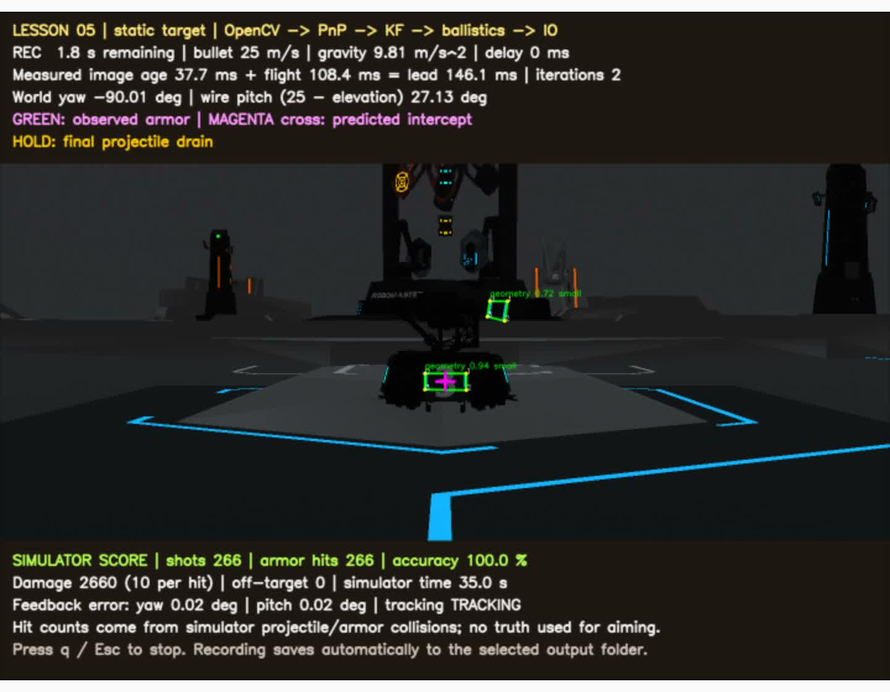
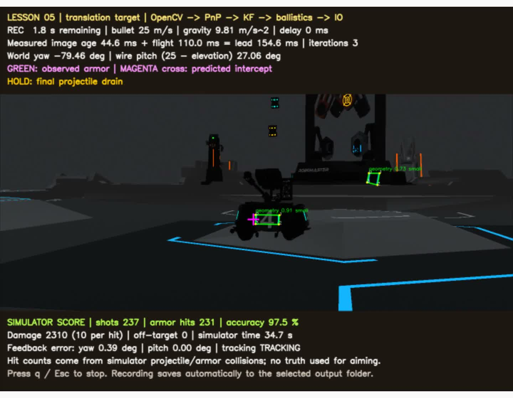

# 第五讲：从看到装甲板，到预测、瞄准和命中

沿用第三、四讲的 **C++ OpenCV → PnP → 六维匀速卡尔曼滤波** 路线，补齐重力弹道、飞行时间迭代、绝对角指令与反馈火控。程序已经在实际 ROS2 / Bevy 仿真中完成静止靶和平移靶击打。

**推荐提交：[60 秒实际窗口录屏 MP4](artifacts/00-static-and-translation-60s.mp4)**。前 30 秒静止靶，后 30 秒平移靶。画面中的发射数、装甲板命中数和伤害来自仿真器独立计分板。

为便于下载，仓库 MP4 压缩为 900×700、12 fps，保留完整 60 秒；本机提交目录保留 1440×1120、25 fps 原录屏，推荐优先上传本机原版。

## 作业要求与证据

| 第五讲要求 | 实现与可检查的证据 |
|---|---|
| 静止靶实际击打，MP4 | 合辑前半段；[逐发事件](artifacts/static-events.jsonl)、[计分板](artifacts/static-score.json) |
| 平移靶实际击打，MP4 | 合辑后半段；[逐发事件](artifacts/translation-events.jsonl)、[计分板](artifacts/translation-score.json) |
| 重力补偿、低伸解、无解不控制 | [弹道与预测](../lessons/lesson05_aiming.cpp)、[接口与参数](../include/aiming.hpp) |
| 处理延迟 + 发弹延迟 + 飞行时间 | 实测图像采集年龄，delay=0；不动点迭代至变化 <0.1 ms，最多 16 次 |
| 世界系绝对 yaw/pitch，25°安装角 | `yaw=atan2(y,x)`；内部 pitch=θ−25°，IO 取负后线上 pitch=25°−θ |
| 云台到位、可信目标才请求开火 | 实测姿态对上一帧指令和当前指令双重门控；[主循环](../src/main.cpp)、[带录制的演示](demo.cpp) |

讲义必交的是两类靶的 MP4，没有提供第五讲表单地址或时长上限。课程平台的上传和正式提交需在老师提供的入口完成。

## 本轮实际验收

2026-11-16 的正式录制结果如下。每轮程序运行 32 秒，最后 2 秒禁止继续发射，留给已发弹丸完成碰撞判定；窗口录屏为其中连续 30 秒。统计包含整轮所有发射，没有按命中片段筛选。预验收与本表属于不同轮次，数据不混用。

| 场景 | 发射 | 装甲板命中 | 命中率 | 车身命中 | 误中其他靶 | 未决弹丸 | 教学伤害 |
|---|---:|---:|---:|---:|---:|---:|---:|
| 静止靶 | 266 | 266 | 100.00% | 0 | 0 | 0 | 2660 |
| 平移靶 | 237 | 231 | 97.47% | 6 | 0 | 0 | 2310 |

平移靶的 6 次车身碰撞算脱靶，未计为装甲板命中。单次教学伤害为 10，不代表真实比赛的完整裁判规则。录制过程中弹丸还在空中时，发射数可能暂时比命中数大；结束后的逐发审计已确认所有弹丸都有唯一碰撞结果。

本轮实测平均图像年龄约为静止 39.29 ms、平移 40.93 ms；实际弹丸平均飞行时间约为 108.69 / 109.75 ms。程序使用每帧测得的年龄，未把讲义的 8 ms 示例硬编码。





可复核材料：

- [独立审计结果](artifacts/audit.json)：逐发发射/碰撞与计分板一致，0 未决；同时核对时钟、预测时间和开火门控。
- [静止指令 CSV](artifacts/static-commands.csv)、[平移指令 CSV](artifacts/translation-commands.csv)：采集时间戳、估计位置/速度、实测延迟、飞行时间、迭代数、角度、开火原因。
- [静止计分过程](artifacts/static-score-history.csv)、[平移计分过程](artifacts/translation-score-history.csv)：带采集时间戳的独立计分遥测。
- [5/5 自动测试](artifacts/tests.log)、[第五讲边界检查](artifacts/ballistic-checks.log)、[MP4 完整解码及媒体信息](artifacts/video-validation.json)。

## 算法怎么工作

可以把程序理解成：先知道靶现在在哪里、往哪走；再算子弹飞多久；最后瞄准那时的靶，等云台对准再请求开火。

1. **保留第四讲感知。** OpenCV 灯条检测与配对得到四角，PnP 得到板位姿，再用图像时刻的 IMU 四元数变换到稳定 FLU 系（x 前、y 左、z 上）。六维 KF 提供同一观测时刻的位置和速度。选板和关联不读取真实目标位置。
2. **统一枪口基准。** 输入 Target 相对云台中心；从中减去 `R_imu * muzzle_gimbal`，得到相对枪口的向量。模型的固定枪口外参约为 `(0.010704, 0.001831, 0.110288) m`，取自刚体 TF；不是用目标真值拟合的修正。相机外参沿用第四讲。底盘在本验收中固定。
3. **解低伸弹道。** 水平距离是 `hypot(x,y)`，高度是相对枪口的 z，弹速来自反馈。令 `a=g*d*d/(2*v0*v0)`、`D=d*d-4*a*(a+h)`，用数值更稳定的低伸根 `tanθ=2*(a+h)/(d+sqrt(D))`，飞行时间 `tf=d/(v0*cosθ)`。D<0、输入非法或水平距离近零时返回无解。
4. **迭代预测。** 用同一个 steady_clock 计算 `age=now-image_timestamp`，仿真 `delay=0`。每轮计算 `p_hit=p_obs+v*(age+delay+tf)`，再解 tf；变化小于 0.1 ms 才认为收敛。失败、过期、未来时间戳、超限都不控制。云台响应滞后没有加入预测时间。
5. **输出绝对角。** yaw 使用相对枪口的截击向量；θ 是弹丸仰角，云台内部仰角为 θ−25°。第二讲 IO 会取负，因此线上 `Command.pitch` 的协议值为 25°−θ；例如水平平射的线上值是 +25°。不能再额外反转一次。
6. **确认到位再请求开火。** 只接受 Tracking 且本帧确有观测的目标。首帧、新目标、失锁后重获先 HOLD；随后用实测云台姿态比较上一帧指令，yaw<0.012 rad、pitch<0.007 rad，同时要求与当前指令误差 yaw<0.018 rad、pitch<0.009 rad。yaw 角差按最短圆周计算。请求还要经过原有 IO 模式、时效、限位及 `allow_fire` 门控。

`solve_aim` 只做可测的求解；`FireControl` 管理需要历史的反馈判断；旧三参数 `lesson05_aiming` 保留为只请求瞄准的兼容接口，并采用讲义中枪口与云台中心重合的简化。实际 [training 主循环](../src/main.cpp) 和 [第五讲演示](demo.cpp) 都使用带当前 IMU、枪口外参与火控状态的完整路径。

未收到新图像的轮询间隙不会反复发送 stop 把限速云台打断；图像超过 200 ms 没更新会发送 stop、重置火控。退出时复用第二讲 Close 发布停止。

### 独立计分与公平条件

视觉算法不接收目标真实位置。演示中 `ScoreMonitor` 独立订阅计分遥测，仅用于画面显示和落盘；`Lesson04Evaluation` 只验收 PnP。目标坐标、真实速度、命中结果均不回送给瞄准算法。

本分支在仿真器新增两处演示支持：环境变量 `RM_LESSON05_AUTOSTART=1` 在选好场景后开始计分；独立真值消息额外携带计分板快照。不修改弹速、重力、碰撞几何、目标运动、云台角速度、发射冷却或命中规则。击打沿用已有 swept 连续碰撞判定；单发只结算首次碰撞。

验收参数：观察位至靶车中心 3 m、弹速 25 m/s、重力 9.81 m/s²、17 mm 弹丸、无空气阻力、云台限速 2.5 rad/s。平移采用仓库现有振幅 0.5 m、周期 4 s 的正弦运动；这与讲义某些定量示例中的 0.3 m 振幅不同。保留原来的已知装甲板 15°倾角先验。

## 在这台电脑上展示

已经编译好的目录：`/home/helio/RM_Lesson05_Work/repo`。第五讲使用 ROS 域 **95**，第四讲是 94；两端都使用本讲入口。

### 先展示静止靶

按 Ctrl+Alt+T 打开终端 1：

```bash
cd /home/helio/RM_Lesson05_Work/repo
bash lesson05/scripts/run.sh simulator static
```

等场地出现约 6 秒，保留终端 1，再打开终端 2：

```bash
cd /home/helio/RM_Lesson05_Work/repo
bash lesson05/scripts/run.sh demo --seconds 32 --scenario static --output /home/helio/RM_Lesson05_Work/my-static-01
```

输出目录必须是没用过的新名字。演示会明确允许本轮仿真开火；根配置中的默认禁火值仍保留。

看标题为 **Lesson05 Ballistics + Live Hits** 的窗口，按这个顺序讲：

1. 绿色框是检测到的板，紫色十字是预测的截击点。
2. 顶部显示实测图像年龄、飞行时间和两者组成的提前量。
3. `FIRE: feedback aligned` 表示云台反馈已接近指令，视觉正在请求开火。
4. 底部 `SIMULATOR SCORE` 的 shots / armor hits 持续增加，这是仿真器碰撞计分。
5. 末尾显示 `HOLD: final projectile drain`，是在停止新增射击、等已发弹丸完成判定。

程序自动结束，也可以点展示窗口按 q / Esc。最后到终端 1 按 Ctrl+C 关闭仿真。

### 再展示平移靶

终端 1：

```bash
cd /home/helio/RM_Lesson05_Work/repo
bash lesson05/scripts/run.sh simulator translation
```

等约 6 秒，终端 2：

```bash
cd /home/helio/RM_Lesson05_Work/repo
bash lesson05/scripts/run.sh demo --seconds 32 --scenario translation --output /home/helio/RM_Lesson05_Work/my-translation-01
```

重点看近处左右运动的车：云台跟随、紫色截击点、FIRE/HOLD 切换，以及底部装甲板命中数增长。靶车换向、估速不稳或云台尚未到位时短暂 HOLD 是火控门控的正常结果。

`--scenario` 是演示标题和记录标签，不负责改变仿真场景；启动前要把终端 1 的 simulator 参数也改对。每轮切场景均重启两个程序，避免旧目标状态混入。

### 一条命令重新录制两段 MP4

先关闭手动启动的两端，避免同一 ROS 域出现两个相机或控制器。在本机当前 X11 桌面运行：

```bash
cd /home/helio/RM_Lesson05_Work/repo
python3 lesson05/scripts/record.py /home/helio/RM_Lesson05_Work/my-recording-01
```

命令自动启动两类场景、打开真实窗口、显示 REC 倒计时、录制后保存 MP4 并关闭自己启动的进程。无需额外录屏快捷键。输出目录同样必须是新名字。该脚本用现有 FFmpeg，不安装软件或修改系统配置。

若在 Wayland，窗口录屏脚本会明确退出；可用系统录屏，或把程序保存的真实显示帧按采集时间导出：

```bash
python3 lesson04/scripts/export_video.py /home/helio/RM_Lesson05_Work/my-translation-01 /home/helio/RM_Lesson05_Work/my-translation-01.mp4
```

后者是实际相机显示帧导出，需与直接窗口录屏区分。本次推荐提交文件使用直接窗口录屏。

## 构建与独立复核

依赖沿用根 README 的 C++ / ROS2 Humble / OpenCV / Eigen / yaml-cpp 与 Rust 1.95.0；运行产物不放入 Git。

```bash
bash lesson05/scripts/run.sh build
bash lesson05/scripts/run.sh test
# 必须重建本分支仿真器，才会有计分遥测和自动开始入口
bash lesson04/scripts/build_simulator.sh
# 对仓库已附数据独立重算，不需要 ROS、GPU 或 Python 第三方库
python3 lesson05/scripts/audit.py
```

本机 Rust 脚本默认离线复用已有缓存。新机器若已具备其他依赖且尚无 Cargo 缓存，可用 `CARGO_NET_OFFLINE=false bash lesson04/scripts/build_simulator.sh`。

五项 CTest 包括第二讲 IO 契约与实际 ROS 收发、第三讲检测、第四讲位姿跟踪、第五讲弹道与火控。第五讲检查物理轨迹终点、低伸解、不可达/非法输入、25°零位、延迟项、不收敛拒绝、过期/未来时间、首帧禁火、丢失/重获、换目标、反馈未到位与跨 ±π 的 yaw。

`audit.py` 不重新运行算法，而是核对每个真实发射 ID 的唯一碰撞结果、装甲板/车身分类、计分一致性、时间戳、delay=0 的提前量关系、协议 pitch 符号及最终停火。审计中的 ≥90% 是本项目自设回归门限，不是老师额外规定的要求。

## 提交时怎么操作

1. 打开合辑 MP4，先看静止段，再看平移段，确认靶在动、计分在增加、文字可读。
2. 到老师提供的**第五讲**入口上传 MP4。
3. 如有代码链接栏，填写 `codex/lesson05-ballistics` 分支或本 README 链接。
4. 等上传完成，点击正式提交，再检查成功提示或提交记录。

说明栏可写：

> 第五讲沿用 C++ OpenCV、PnP 与匀速卡尔曼滤波，实现无阻力重力弹道低伸解、实测处理延迟与飞行时间的迭代截击，以及基于云台反馈的火控。视频前后分别为静止靶和平移靶；本轮仿真实测 266/266、231/237 次装甲板命中。逐发碰撞、指令 CSV、自动测试和独立审计见仓库 README。

## 适用范围

本次完成讲义要求的固定观察车、静止靶和平移靶仿真任务。使用已知尺寸与倾角先验；没有实机标定、真实发弹延迟验收、移动底盘补偿或旋转整车建模。正弦运动的换向、图像/PnP误差、速度估计和有限云台响应仍会造成脱靶，因此保留全部失败记录。实机 delay=0.11 s 不能直接照搬本次仿真结果。
